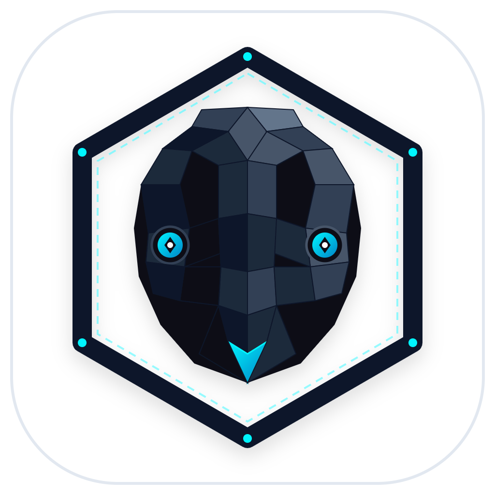
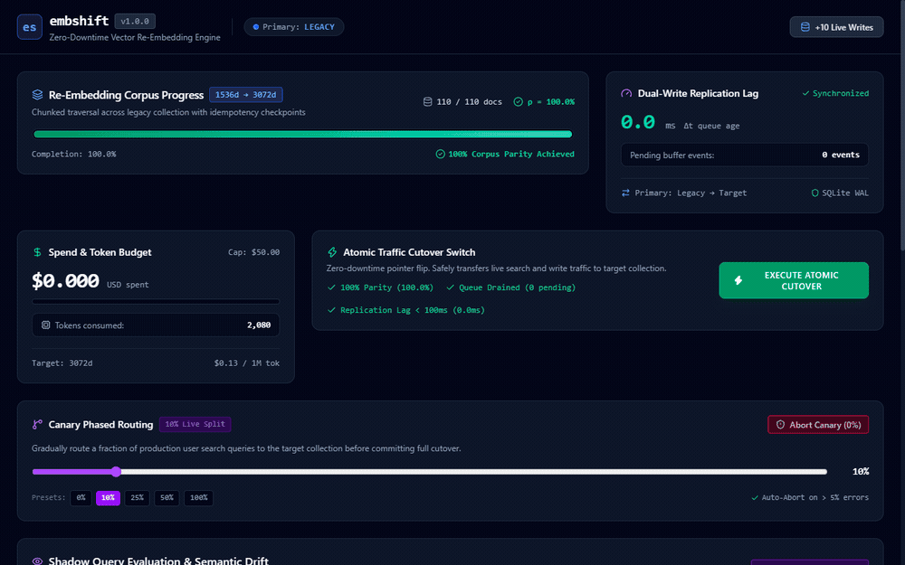
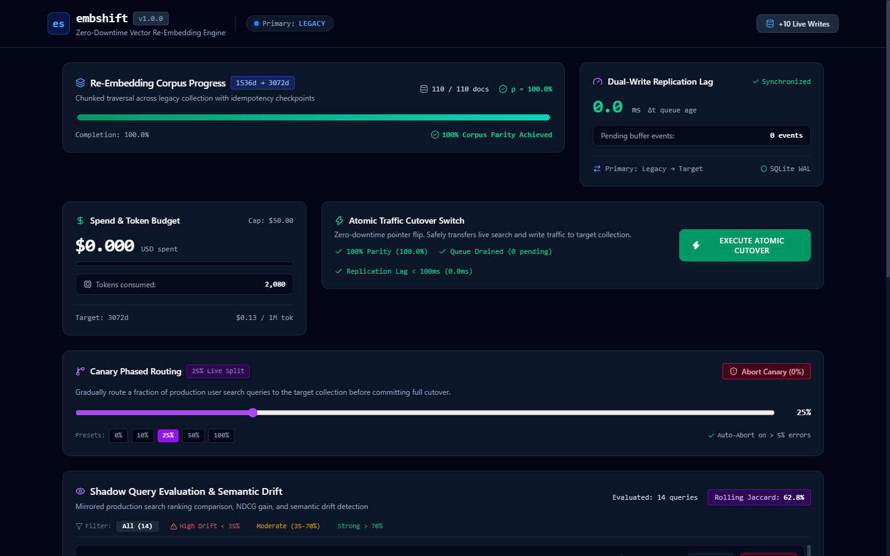
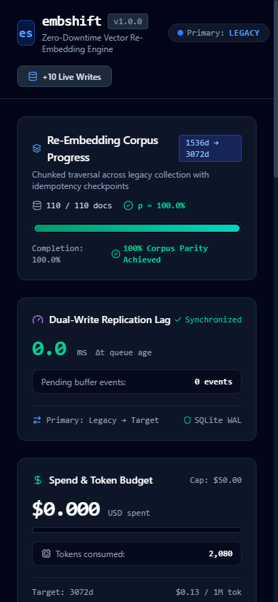

<p align="center">
  
</p>
<h1 align="center">embshift</h1>
<p align="center">
  <strong>Zero-Downtime Vector Database Migration & Shadow Re-Embedding Engine</strong>
</p>
<p align="center">
  <a href="https://github.com/alexandrmotologa/embshift/actions"></a>
  <a href="https://golang.org"></a>
  <a href="https://react.dev"></a>
  <a href="https://prometheus.io"></a>
  <a href="https://sqlite.org"></a>
  <a href="LICENSE"></a>
</p>

<p align="center">
  
</p>

```
       +-------------------------------------------------------------+
       |               Client Application / RAG Ingestion            |
       |       (Configured with Vector Endpoint: http://embshift)    |
       +-------------------------------------------------------------+
                                      |
                      Write / Query / Delete Operations
                                      v
       +-------------------------------------------------------------+
       |                     embshift Core Engine                    |
       |                    (High-Performance Go CLI)                |
       |                                                             |
       |  +---------------------+        +------------------------+  |
       |  | Dual-Write Router   |------->| Asynchronous Shadow    |  |
       |  | & Idempotency Gate  |        | Event Queue (SQLite)   |  |
       |  +---------------------+        +------------------------+  |
       |              |                               |              |
       |       Sync Write / Query                     v              |
       |              |                  +------------------------+  |
       |              |                  | Controlled Rate-Limited|  |
       |              |                  | Backfill Orchestrator  |  |
       |              |                  +------------------------+  |
       |              v                               |              |
       |       +---------------+                      v              |
       |       | Legacy Store  |               +---------------+     |
       |       | (Ada-002)     |               | Target Store  |     |
       |       | 1536 Dims     |               | (Voyage/3072d)|     |
       |       +---------------+               +---------------+     |
       |              |                               |              |
       |              +---------------+---------------+              |
       |                              |                              |
       |                              v                              |
       |  +-------------------------------------------------------+  |
       |  |          Shadow Query Comparator & Quality Gate       |  |
       |  |  * Mirrors configurable fraction of live queries      |  |
       |  |  * Computes rank correlation & retrieval parity       |  |
       |  |  * Phased Canary traffic splitting (0% -> 100%)       |  |
       |  +-------------------------------------------------------+  |
       |                              |                              |
       |         Parity = 100% && Quality Gate Passed                |
       |                              v                              |
       |  +-------------------------------------------------------+  |
       |  |              Atomic Traffic Cutover Switch            |  |
       |  |  Target becomes Primary; Legacy safely buffered       |  |
       |  +-------------------------------------------------------+  |
       |                              |                              |
       +------------------------------|------------------------------+
                                      |
                                      v
       +-------------------------------------------------------------+
       |                  Control and Inspection Surfaces            |
       |  1. Embedded React 19 Migration Studio (HTTP :8787)         |
       |  2. Real-Time Backfill Progress & Dual-Write Lag Gauge      |
       |  3. Dead-Letter Queue (DLQ) Inspector & Poison-Pill Retry   |
       |  4. Prometheus Metrics Exporter (HTTP :8080/metrics)        |
       |  5. Non-Repudiable Migration Audit Manifest (audit.json)    |
       +-------------------------------------------------------------+
```

## Problem Statement

When upgrading foundation embedding models in production RAG systems (for example, migrating from 1536-dimensional OpenAI Ada-002 to 3072-dimensional text-embedding-3-large or Voyage-3), engineering teams face four fundamental obstacles:
1. Mathematical incompatibility. Vectors from different models cannot be queried in the same vector space. Cosine similarity between an Ada-002 query and a text-embedding-3 vector is undefined.
2. Search downtime. Shutting down the legacy index during backfill stops semantic search and retrieval workflows.
3. In-flight drift. New writes and deletes occurring during hours of batch re-embedding cause state divergence between indices.
4. Unverified retrieval quality. Teams lack empirical proof that the target index maintains or improves retrieval accuracy on live production query distributions before cutover.

embshift resolves these issues by acting as a transparent proxy that coordinates dual-writing, manages rate-limited backfills with token budget caps, runs live shadow query evaluations, and executes atomic cutovers with instant rollback support.

## Migration Cockpit

The single binary embeds a lightweight React 19 single-page application communicating over Server-Sent Events (SSE). It exposes controls for live dual-writing replication latency, spend tracking, dead-letter queue (DLQ) retry management, phased canary traffic routing, and atomic cutover execution.

<p align="center">
  
</p>

### Responsive Multi-Device Cockpit

The cockpit adapts to both high-resolution operations displays and mobile incident response screens:

<p align="center">
  
</p>

## Core Capabilities

- Transparent Dual-Writing Proxy: Commits writes and deletes synchronously to the active primary store while asynchronously staging updates to the target store via an embedded SQLite WAL queue.
- Rate-Limited Backfill Orchestrator: Traverses legacy collections with cursor pagination, pacing embedding API requests through a token bucket rate limiter with dollar budget caps.
- Production Shadow Query Evaluation: Mirrors a configurable fraction of live search traffic to the target store, computing Jaccard similarity and NDCG without adding latency to client responses.
- Phased Canary Traffic Routing: Progressively routes read traffic (0% to 100%) to the target index with automated abort guards triggered on error rate anomalies.
- Dead-Letter Queue (DLQ) & Poison-Pill Inspector: Sequestrates corrupted or oversized documents after retry thresholds, allowing live inspection and retry from the web studio.
- Asymmetric Prefix & Template Engine: Supports prompt prefixes required by modern embedding architectures (such as `passage: ` and `query: ` for Voyage, BGE, and E5 models).
- Prometheus Observability Exporter: Serves `/metrics` in the standard exposition format for immediate ingestion by Prometheus, Datadog, or Grafana.
- Atomic Zero-Downtime Cutover: Executes an in-memory pointer swap to reroute production traffic once corpus parity reaches 100% and quality gates pass.
- Reverse Dual-Writing Rollback: Automatically replicates updates backward from target to legacy post-cutover, allowing an immediate one-click rollback if anomalies arise.
- Embedded React 19 Cockpit: Delivers a real-time web interface over Server-Sent Events (SSE) inside a single Go binary consuming under 20MB of RAM.

## Mathematical Formulation

### 1. Document Parity Ratio (rho_parity)
Let D_legacy be the set of document IDs in the legacy store and D_target the set of re-embedded documents in the target store:

$$\rho_{\text{parity}} = \frac{|\mathcal{D}_{\text{legacy}} \cap \mathcal{D}_{\text{target}}|}{|\mathcal{D}_{\text{legacy}}|}$$

A migration is eligible for cutover only when rho_parity = 1.0 and replication lag is zero (Delta t_lag = 0).

### 2. Shadow Rank Overlap (Jaccard@K)
For mirrored production query q, let L_legacy(q) and L_target(q) represent the top-K retrieved document IDs:

$$\text{Jaccard@K}(q) = \frac{|L_{\text{legacy}}(q) \cap L_{\text{target}}(q)|}{|L_{\text{legacy}}(q) \cup L_{\text{target}}(q)|}$$

Rolling average rank correlation verifies retrieval parity across live user queries.

## Quickstart

### 1. Run the Self-Contained Demo Simulation
Clone the repository and run the built-in demo. This mode starts an in-memory legacy store with 100 documents, runs live traffic, and opens the Migration Studio without requiring external database dependencies:

```bash
git clone https://github.com/alexandrmotologa/embshift.git
cd embshift
go run ./cmd/embshift demo
```

Open your browser to `http://localhost:8787` to monitor backfill progress, replication lag, canary traffic, and execute the atomic cutover.

### 2. Run the Verification Test Suite
Execute unit tests across the queue, proxy, backfill orchestrator, shadow evaluator, and REST server:

```bash
go test -v ./...
```

Run the end-to-end simulation script verifying zero dropped requests under concurrent write load:

```bash
go run ./examples/simulation.go
```

### 3. Build Single Binary
Compile the embedded React 19 frontend and Go binary:

```bash
# Build frontend and binary
make build

# Start production proxy with custom configuration
./embshift.exe start --config examples/embshift.yaml
```

## Configuration Reference

Configuration files use YAML syntax (`embshift.yaml`):

```yaml
proxy:
  host: "0.0.0.0"
  port: 8080
  studio_port: 8787

legacy:
  type: "qdrant" # "qdrant", "pgvector", "pinecone", "mock"
  endpoint: "http://localhost:6333"
  api_key: ""
  collection: "production-v1"
  dimensions: 1536
  model: "text-embedding-ada-002"

target:
  type: "qdrant"
  endpoint: "http://localhost:6334"
  api_key: ""
  collection: "production-v2"
  dimensions: 3072
  model: "text-embedding-3-large"

embedder:
  legacy:
    type: "openai"
    endpoint: "https://api.openai.com/v1"
    api_key: "sk-..."
    model: "text-embedding-ada-002"
    dimensions: 1536
    document_prefix: ""
    query_prefix: ""
  target:
    type: "openai"
    endpoint: "https://api.openai.com/v1"
    api_key: "sk-..."
    model: "text-embedding-3-large"
    dimensions: 3072
    price_per_million_tokens_usd: 0.13
    document_prefix: "passage: "
    query_prefix: "query: "

backfill:
  batch_size: 100
  concurrency: 4
  requests_per_minute: 3000
  tokens_per_minute: 1000000
  max_budget_usd: 50.00
  text_field: "text"
  max_retry_attempts: 3 # Move poison pills to DLQ after 3 failures

shadow:
  sample_ratio: 0.25 # Mirror 25% of live production search requests
  top_k: 10
  min_jaccard_threshold: 0.40

cutover:
  require_parity_ratio: 1.0
  max_replication_lag_ms: 100.0
  require_zero_pending_queue: true
  enable_reverse_replication: true
  initial_canary_weight: 0.0 # 0% canary traffic initially
  max_canary_error_rate: 0.05 # Auto-abort canary on > 5% errors

storage:
  sqlite_path: "embshift.db"
```

## API Specification

### Data Plane (Vector Ingestion & Search)
- `POST /v1/vectors/upsert`: Ingest vectors or raw text records. Synchronously commits to primary and enqueues to secondary.
- `POST /v1/vectors/query`: Execute vector or text search. Returns primary results immediately and asynchronously mirrors queries for shadow quality scoring.
- `POST /v1/vectors/delete`: Delete vectors by ID across collections.

### Observability & Metrics
- `GET /metrics`: Standard Prometheus metrics exposition (lag, pending queue, DLQ count, tokens, spend, canary weight).

### Management & Control Plane
- `GET /api/status`: Retrieve real-time telemetry (parity, lag, spend, state, canary weight).
- `POST /api/backfill/start`: Initiate background backfill.
- `POST /api/backfill/pause`: Pause background backfill.
- `POST /api/backfill/resume`: Resume background backfill.
- `POST /api/canary/set`: Configure phased read traffic splitting (`{"weight": 0.25}`).
- `POST /api/canary/abort`: Abort canary traffic back to 0%.
- `GET /api/dlq`: List poison-pill records in Dead-Letter Queue.
- `POST /api/dlq/retry`: Re-enqueue a DLQ record for replication (`{"id": 123}`).
- `POST /api/dlq/purge`: Permanently delete a DLQ record (`{"id": 123}`).
- `POST /api/cutover`: Execute atomic traffic switchover and generate audit manifest.
- `POST /api/rollback`: Revert primary routing to legacy collection.
- `GET /api/audit`: Retrieve cryptographic audit manifest.
- `GET /api/events`: Server-Sent Events (SSE) telemetry stream.

## Documentation

- [Architecture Invariants](docs/ARCHITECTURE.md)
- [Production Runbook](docs/RUNBOOK.md)
- [Performance Benchmarks](docs/BENCHMARKS.md)

## License

MIT License.
